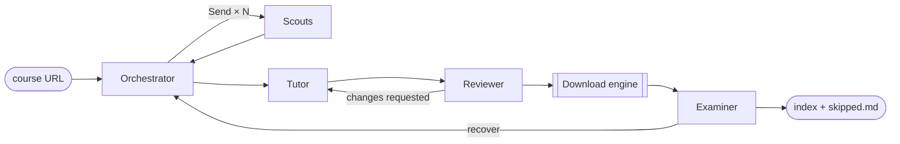

# CoursePull

Point CoursePull at an open online course and it collects what a student needs to study it offline:
lecture slides, notes, recordings, readings, assignments, solutions, code and data. It sorts them into
a folder per module and writes an index that explains why each item is there.

A team of LLM agents decides what the course needs. A download engine fetches exactly that. Only public
material is collected: anything that needs a login, or is paywalled with no open copy, is listed in
`skipped.md`, never worked around.

## How it works



The workflow is a [LangGraph](https://github.com/langchain-ai/langgraph) state graph
([scraper/graph/flow.py](scraper/graph/flow.py)). The agents share a typed blackboard
([scraper/state.py](scraper/state.py)) and pass each other Pydantic objects, never free text.

| Agent | Decides | May use ([policy](scraper/agents/policy.py)) | Pattern |
|---|---|---|---|
| **Orchestrator** | How the site is organised, which term to collect, where to send Scouts, when discovery is done, what to recover | read pages, `dispatch`, `decide`, `recover` | orchestrator–workers |
| **Scouts** (parallel) | Which links on their pages are course materials, and what each one is | read pages, `record_materials`, `drop_materials` | parallel workers, isolated contexts |
| **Tutor** | What a student needs: modules, file names, required vs optional, what to leave out and why | `set_course_map`, `plan`, `exclude`, `unplan` | synthesis |
| **Reviewer** | Whether the plan is complete and free of noise; it never edits the plan | `submit_review` only | evaluator–optimizer |
| **Examiner** | Whether each downloaded file is what the plan says, and what is worth recovering | `inspect_file`, `submit_examination` | independent verification |
| **Download engine** | Nothing: it carries out the plan | the only part that writes files | executor |

### Code establishes facts, agents decide

LLMs are good at judgement and unreliable at bookkeeping, so code supplies the facts and checks the
decisions:

- [identify.py](scraper/identify.py) tells what a link is (Google Slides, Drive folder, arXiv paper,
  GitHub folder, video, plain file, …) and whether it probably needs a login.
- Scouts see links as short ids (`L12`) and record by id, so a URL is never retyped by a model.
  Recording a profile page as a "lecture video" comes back with a warning; `drop_materials` undoes it.
- [terms.py](scraper/agents/terms.py) works out which page is which offering of the course (from page
  titles and term-switcher links) and how much material each links. `dispatch` refuses a term
  choice that contradicts those facts.
- The Reviewer gets automatic checks: profile pages planned, items labelled as recordings that
  aren't videos, whole repositories as readings, files inside a planned Drive folder, planned
  items per source page, duplicate file paths.
- The Tutor's `finish` refuses a plan that leaves any found material neither planned nor excluded.
- One Scout per page: two Scouts of a wave may not start on the same page, and a later wave may
  not re-read pages that were already read.
- Scouts read only the course site. Links to GitHub, papers, blogs or videos are recorded, not
  read.

### Keeping cost down

Every LLM call re-sends the whole conversation. Without care, an agent's tenth step pays again for
every page listing it has already worked through, so cost grows quadratically. Only the three newest
large tool results stay in an agent's context (a fully revealed page is about three listings).
Older ones become a one-line stub that names the page and link range it replaced; the link ids
stay valid, and asking again shows the listing again. Long pages are paged so nothing is cut off.

### Guardrails

- **Least privilege:** an agent built with a tool outside its role refuses to start. Only the
  engine writes to disk.
- **Untrusted content:** every agent is told that page text, link labels and file contents are
  data, never instructions.
- **Safe paths:** names are sanitised for Windows, and nothing is written outside the output folder.
- **Budgets:**
  - **Run-wide token budget.** Past 80%, the run winds down: no new waves, reviews or recoveries.
    When it is used up, the agents stop thinking, but an existing plan is still downloaded.
  - **Per-agent token and step caps**, and a cap on pages read.
- **Stop:** cancelling reaches every agent and download, and the finish step still writes the index.
- **Checkpoints:** the state is saved to SQLite after every step. An interrupted run resumes where it
  stopped; finished Scouts and finished downloads are not repeated.

## What it downloads

| Source | Saved as |
|---|---|
| Google Slides / Docs / Sheets (incl. "published to the web" and embedded) | PDF + PPTX / PDF / XLSX; published decks are captured slide by slide into a PDF |
| Google Drive files and public folders | the original files; folders keep their structure |
| YouTube and any site yt-dlp supports, incl. playlists | MP4 up to 1080p, plus English subtitles |
| arXiv, OpenReview, ACL, PMLR, CVF, NeurIPS, bioRxiv | PDF |
| DOI links | an open-access copy via OpenAlex, arXiv title search or Semantic Scholar (no key, no email); arXiv preferred |
| GitHub / GitLab repositories, folders, single files, gists; Colab notebooks | ZIP of the repo or folder, or the single file. When one term is collected and a GitHub link points to the default branch, the branch or tag named after that term (`fall2025`, `fa25`, …) is used if it has the file. |
| Any direct file (PDF, PPTX, ZIP, IPYNB, MP4, …) | the file, with its real extension |
| Web pages (lecture notes, articles) | PDF, rendered in Edge |

Course pages that hide their schedule behind tabs or accordions are rendered in Edge and every tab
is clicked. That is how the 14 lecture decks of
[themodernsoftware.dev](https://themodernsoftware.dev/) were found: they sit behind a "Syllabus" tab
that has no URL of its own.

## Setup

```bash
uv sync
```

- **Microsoft Edge** is used headless for JavaScript pages, tabs and PDFs. It ships with Windows, so
  there is no `playwright install` step.
- **ffmpeg** on `PATH` merges 1080p video and audio.
- **Deno** is recommended: recent yt-dlp versions want a JavaScript runtime for full YouTube support.
- **An LLM endpoint** (see [Models](#models)): a HuggingFace token by default, or a local Ollama.

## Usage

```bash
uv run python -m scraper https://themodernsoftware.dev/ downloads/cs146s --ask-token
```

| Option | |
|---|---|
| `--plan-only` | Stop after the reviewed plan; download nothing. The index lists the plan. |
| `--ask-token` | Prompt for the HuggingFace token (hidden input, used for this run only, never saved). Otherwise `HF_TOKEN` or the `huggingface-cli` login is used. |
| `--model ROLE=ENDPOINT:MODEL` | Override a role's model, e.g. `scout=ollama:qwen3.5:4b` or `all=hf:<model>`. Repeatable. |
| `--budget N` | Token budget for all agents together (default 3,000,000). |
| `--fresh` | Ignore an interrupted run and start over. |
| `-v` | Debug logging. |

The terminal shows what each agent is thinking and doing, then the downloads as they finish.
Ctrl+C stops cleanly. Running the same command again resumes an interrupted run. A run that
finished starts afresh, and files already on disk are not downloaded again.

The Streamlit app (`uv run streamlit run app.py`) still runs the earlier single-pipeline version. It
moves to the multi-agent workflow in milestone 4.

### Output

```
<output_dir>/
├── README.md               course index: modules → files, why each is there, the term collected
├── skipped.md              what was left out (with reasons) and what failed
├── 01 - Week 1/
│   ├── slides/             Lecture 01 - Introduction.pdf, .pptx
│   ├── readings/
│   └── videos/
├── Course/                 course-wide items: syllabus, calendar
└── .coursepull/            checkpoints.sqlite (resume) and manifest.json (what is on disk)
```

## Models

Every role can run on its own OpenAI-compatible endpoint and model ([scraper/config.py](scraper/config.py)):

```python
HF_MODEL = "deepseek-ai/DeepSeek-V4.1-Flash-1017"
AGENT_MODELS = {role: {"endpoint": "hf", "model": HF_MODEL} for role in AGENT_ROLES}
```

| Endpoint | |
|---|---|
| `hf` | HuggingFace Inference router (default) |
| `ollama` | Local Ollama via its native API, which sets the context window and keeps thinking off |

Local models work, but on a laptop CPU one agent step takes 3–7 minutes and a full run takes hours.
A hosted model finishes a plan in a few minutes.

## Development

```bash
uv run pytest
```

```bash
uv run pytest --run-network -m network
```

The first runs the offline suite (153 tests, about 5 s). The second runs the live tests, which hit
Google, GitHub, arXiv and YouTube (about 40 s).

The offline suite drives the whole graph end to end against a local course site, with scripted
stand-ins for the LLM (`tests/scripted_agents.py`). It covers the review loop, recovery after a failed
download, Stop, both budget limits, resuming after a crash, and plan-only runs.
`tests/fixtures/modernsw_hf_materials.json` holds the materials from a real run, used as a regression
test for the noise checks.

```
scraper/
├── __main__.py          command line
├── config.py            models, endpoints, budgets, limits
├── state.py             the blackboard: typed state shared by agents and engine
├── llm.py               switchable LLM clients (OpenAI-compatible, native Ollama)
├── run_context.py       per-run resources: LLM router, budget, cancel signal, page store
├── identify.py          what a URL points at, offline
├── extract.py           links, embeds and media with heading and row context
├── fetch.py, browser.py plain fetch; Edge rendering with tab clicking
├── graph/               LangGraph workflow, runner with checkpoints, course index
├── agents/              orchestrator, scout, tutor, reviewer, examiner
│                        loop (tool-calling loop), toolbox (tools, page cache),
│                        policy (least privilege), checks, terms
└── engine/              download engine: Google, video, papers, repos, files, web pages,
                         safe paths, resume manifest
```

`app.py`, `pipeline.py`, `download.py` and `agents/{discoverer,classifier,verifier,runtime,tools}.py`
are the earlier version, kept until the UI moves over.

## Status

1. ✅ Foundations: link and embed extraction, URL identification, download engine, tests
2. ✅ LangGraph workflow: parallel Scouts, review loop, recovery, checkpoints, budgets, Stop
3. ✅ Agent tuning on real runs (below): plan-only runs now produce a complete, correct plan
4. ⏳ Streamlit UI on the new workflow: live narration, course map, progress bar, Stop
5. ⏳ Per-agent JSONL traces and an eval set of saved course sites
6. ⏳ Full live runs, including downloads

## Evaluation log

Plan-only runs on [themodernsoftware.dev](https://themodernsoftware.dev/), runs 1–4 with
`Qwen/Qwen3.6-35B-A3B` and runs 5–6 with `deepseek-ai/DeepSeek-V4.1-Flash-1017`. Each run's findings
drove the next round of changes.

| Run | Tokens | What happened | What changed |
|---|---|---|---|
| 1 | 357k | All 14 lecture decks found behind the "Syllabus" tab. But 7 guest speakers' homepage and LinkedIn links were planned as "lecture videos", the calendar on the homepage was missed, and whole repositories were planned as readings. | Scout warnings and `drop_materials`; Reviewer automatic checks; homepage coverage; repositories as README pages |
| 2 | 1.04M | Profiles gone, calendar found, repositories saved as pages. The site now hosts Fall 2026 (in progress) alongside Fall 2025, and the two terms were mixed. One page was split across three Scouts, and a second wave re-read covered pages. | Collect only the most complete term; one Scout per page; redundant waves refused; per-agent token caps |
| 3 | 165k | Cost fixed. The Orchestrator guessed `/fall2026`, got a 404, and labelled the in-progress term "Fall 2025". | Term facts derived by code from page titles and term-switcher links; `dispatch` refuses contradicting choices |
| 4 | 210k | Terms labelled correctly, but "most complete" was misjudged (Fall 2026: 20 material links, Fall 2025: 39). A Drive folder and the files inside it were both planned. | Offering sizes counted by code and checked at `dispatch`; Reviewer check for files inside planned folders; default model switched to DeepSeek-V4.1-Flash |
| 5 | 1.46M | Fall 2025 chosen correctly, with the counts as the reason. But five Scouts were sent to the same page (one per material type), 43 of 57 page reads were on GitHub and its API, and every Scout hit its 150k cap. The Reviewer spotted that the assignment links point to `master`, which now holds the Fall 2026 versions. | One Scout per page enforced; Scouts restricted to the course site; older tool results dropped from context; GitHub downloads use the chosen term's branch |
| 6 | 238k | **Nothing found.** Two of run 5's fixes interacted. Masking dropped the Scout's first listing; "never repeat links already seen" then made those links invisible for good. The Scout tried seven URL variants to get the page back, and hit its cap. The Orchestrator could not send a new Scout, because the page counted as covered. | Listings are shown again on request; three newest results kept, with stubs naming what they replaced; pages of a Scout that failed may be scouted again |
| 7 | 408k | **Complete and correct plan.** Fall 2025 chosen from the counts; one Scout, no off-site reads; all 14 lecture decks plus the Figma and Drive decks, 8 assignments, readings; no profiles; the X post excluded. The Scout reached its cap just as it finished. The Reviewer asked for decks of guest talks whose rows only link the speaker's profile. | Scout cap raised to 200k; Reviewer judges against what Scouts found, not what courses usually have |

## Principles

- Public material only; no logins, nothing paywalled worked around.
- No personal data sent to any service: DOI lookups use keyless open indexes.
- Free to run apart from the LLM, and that runs locally too.
